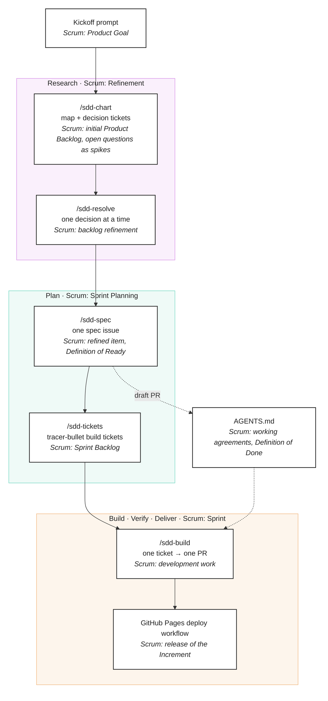

## AI in the SDLC - Session 4
## SDD Demo: from a prompt to a shipped increment

This repo is the starting point for a live demo of **spec-driven development (SDD)** with an AI coding agent.

We take one rough idea, an online tic-tac-toe and checkers app with rooms, no backend and hosting on GitHub Pages, and carry it from a single prompt to merged, deployed code. We don't ask the agent to "just build it". Each step leaves a reviewable artifact on GitHub: a map of open decisions, a spec, small build tickets, and one pull request per ticket. A person approves at each gate.

The repo holds no app code yet, only the SDD skills in [.claude/skills/](.claude/skills/). The app is built during the demo.

This README covers:
1. **Prompting:** the rough prompt we start from, and what a well-structured version of it looks like.
2. **SDD skills:** the five phases, what each one produces, and where a person signs off.
3. **Mapping:** how each phase lines up with the course steps and with Scrum, so the process fits how teams already work.

## Prompting

### Initial Prompt

> I want to create a web app that allows people to create rooms and play checkers and tic-tac toe online. For that I am thinking of using peer-js (WebRTC) library. I don't want to setup a backend, it should be client-side only. I want to host the website through GitHub pages. Perhaps we start only with tic tac toe since it's a more simple game than checkers. I want the game implemented from scratch without using any libraries (we code the game ourselves) so we have full control. Users should be able to enter the website, choose the game (checkers or tic-tac-toe), create a room after entering their name, which will generate a dynamic route, and then they can share with their friends, which can join the room with their name. I want them to be able to choose an emoji as an avatar. Let's use React for the web app. We have one hour to implement the first version of the app: the first version is what should be mapped here.

### Good prompting

A good prompt sections:
- Goal and why
- Context
- Done when
- Limits
- Example
- How to work
- Output and check

#### Example of good output:

```md
## Goal
Customers keep asking support for their order history. Let them download it from the account page.
## Context
Read `OrdersService` and the account page first. Reuse the CSV helper in `reports/`. Don't guess about code you haven't opened.
## Done when
A CSV of the signed-in customer's orders. `OrdersExportTest` passes; no orders gives headers only.
## Limits
Only the signed-in customer's data. No new dependencies. Not in scope: email, other formats.
## Example
Same columns as the invoice CSV: date, order number, items, total, status.
## How to work
First list your questions and a short plan. Then wait for my go-ahead.
## Output · check
A small diff. Run the tests and show me the output. If a test looks wrong, tell me instead of changing it.
```

## SDD Skills

### Phase by phase
| SDD phase | What it does | Course step | Scrum | Human gate |
|-|-|-|-|-|
| `/sdd-chart` | Grills the destination and the open decisions, breadth first.<br>Publishes the map and one ticket per decision;<br>starts research subagents in the background. | **Research**<br> Frame step: agree the question and what's out of scope. | **Refinement**<br> The map's Destination plays the Product Goal. | Confirm destination, time box and ticket list |
| `/sdd-resolve` | Settles one decision per run:<br> grills a person on `sdd:grilling`, summarises findings on `sdd:research`.<br> Writes the decision, why, and what it means for the spec. | **Research**<br> Explore, Challenge, Write.<br>Grilling is the Interview pattern. | Refinement<br>Breaking down and further defining items. | Decide each grilling question; facts are the agent's job |
| `/sdd-spec` | Synthesises every decision into one spec issue (problem, stories, modules, testing, assumptions).<br>Opens a draft PR with an AGENTS.md proposal. | **Plan**<br> Spec-driven development and a minimal spec.<br>AGENTS.md. | **Refinement**<br>Items get ready for Sprint Planning. | Correct the spec; review the AGENTS.md PR |
| `/sdd-tickets` | Slices the spec into tracer-bullet tickets, each end to end and demoable,  sized to one agent session, wired with blocked-by edges. | **Plan**<br>Split until each task can  be reviewed in one sitting. | **Sprint Planning**<br>Decompose items into small work;<br>the result is the Sprint Backlog. | Approve granularity and edges (the team accepts the plan) |
| `/sdd-build` | Claims one unblocked ticket,<br>works in a fresh worktree,<br>writes logic test first,<br>runs every acceptance criterion,<br>opens a PR that says how each was checked. | **Build**<br> one small task at a time.<br>**Verify**<br>AI checks its own work first. | **Sprint**<br>The tracker's frontier is what the Daily Scrum looks at. | None inside; it stops at the PR |
| **Review & Merge** | A person reads intent and risk and merges.<br>The merge closes the ticket and unblocks the next ones. | **Verify & review**<br>A person who didn't write it approves. | **Definition of Done**<br>An Increment is born. | Approve the PR |


### Overview



### The same artifacts, three names

| Scrum artifact | SDD on GitHub | Course: what the step leaves |
|-|-|-|
| Product Goal | `sdd:map` Destination and Out of scope | The intent: problem, outcome, constraints |
| Product Backlog | Decision tickets, then the `sdd:spec` user stories | The intent's open questions, then the spec  |
| Sprint Backlog | `sdd:build` tickets with blocked-by edges | The plan: small tasks, in order, with the tests that prove each |
| Increment | Merged PR that closes its ticket, criteria ticked | An approved pull request |
| Definition of Ready (team practice) | Ticket unblocked, criteria checkable in a browser | or a test | Plan's people check |